# Architecture: AI Invoice Ingestion Platform

## Summary

**The problem.** A clinical trial site sends an invoice to the drug company paying for the trial (the
sponsor). Someone has to tie the invoice to the right sponsor, study and site, and check each billed
line against the approved items and prices for that sponsor and study (the catalog). The take-home
brief adds one hard rule: line items may only be matched after a person has confirmed the sponsor
and study, because those decide which catalog applies.

**The approach.** One Python web app, built with FastAPI and plain server-rendered pages, runs as a
third container next to the provided reference API and its Postgres database. It keeps its own data
in an SQLite file on a Docker volume. Claude (`claude-opus-5-5`) reads each uploaded file and later
suggests a catalog item for each line. Matching the invoice's header facts to sponsors, studies and
sites is ordinary code. Every step is guarded by a stored status on the invoice, and the server
refuses any step whose status is wrong, which is what makes the confirmation gate real.

**Where the project stands.** The intent (`docs/DESIGN.md`, tagged `tortoise/ideas`) and the spec
(`docs/SPEC.md`, 63 requirements, tagged `tortoise/spec`) are approved. This document is the
architecture, approved and tagged `tortoise/architecture`. All four milestones are built: the app skeleton,
database, reference API client, status guard, upload screen, Claude client, extraction, metadata
suggestions, the confirmation gate, line matching, price flags, the review screen, finalizing, the JSON
download, the live tests and delivery.

Requirements are referred to by name with their spec number in brackets, such as "the gate refusing
early matching (R28)".

## Diagrams in this document

| Diagram | Included? | Why |
|---|---|---|
| System overview | Yes | Always drawn. |
| Main parts | Yes | Always drawn. |
| Database diagram | Yes | Always drawn. |
| Request flows | Yes, five | One for each important user action. |
| User flow | Yes | Always drawn. |
| State diagram | Yes | The invoice's status changes over time and controls everything. |
| Data flow | Yes | Invoice files and catalogs are sent to an outside AI model. |
| Background jobs | Yes | Extraction and matching run in the background with retries. |
| Deployment | Yes | Three containers, not one process. |
| Code structure | Yes | More than five modules. |
| API map | No | No separate front end or system calls the app; its pages and form posts are listed as a route table instead. |
| Login and permissions | No | One user, no login (out of scope in the spec). |
| Business process | No | The work does not pass between people or roles; one person does every step. |

## 1. System overview

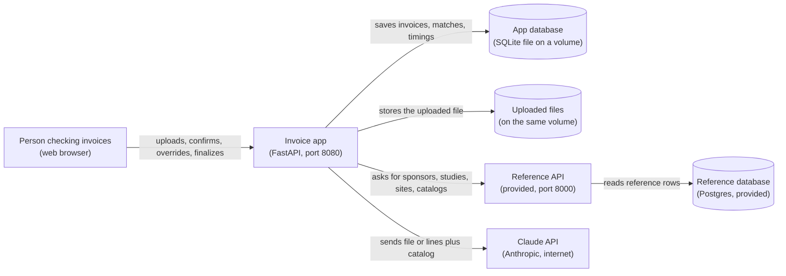

This shows every part the system has and what travels between them: the app is the only thing the
browser talks to, it alone calls Claude and the reference API, and it never touches the reference
database directly (the rule against reading the reference database, R6).

The answers that come back along each arrow are described in the request flows in section 4: the
reference API returns JSON lists, and Claude returns JSON in a fixed shape.

## 2. Main parts

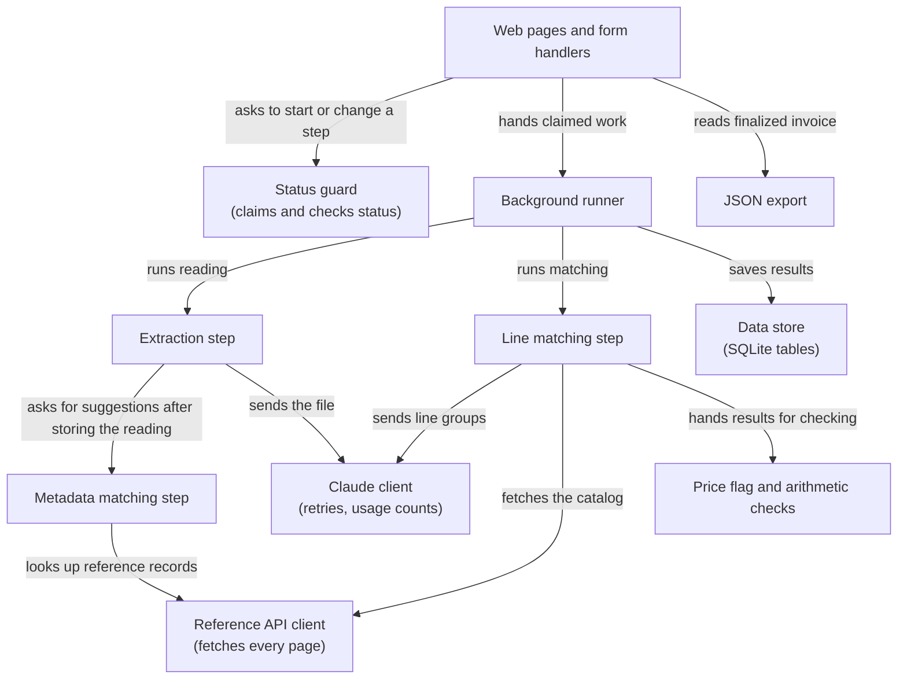

Eleven parts, each one module (section 12 gives the file names):

1. **Web pages and form handlers** show each screen and receive the user's actions.
2. **Status guard** is the only code that changes an invoice's status. It checks that the requested
   action is allowed from the current status and claims the invoice in one database update (the
   one-at-a-time claim, R29).
3. **Background runner** runs claimed work after the page has answered, so the browser never waits
   on Claude.
4. **Extraction step** sends the uploaded file to Claude and stores what comes back.
5. **Metadata matching step** suggests a sponsor, study and site with confidence levels and reasons,
   in plain code.
6. **Line matching step** groups the lines, asks Claude for matches, checks every answer and stores
   results as they arrive.
7. **Price flag and arithmetic checks** compare prices and add up amounts, in plain code.
8. **JSON export** builds the download for a finalized invoice.
9. **Reference API client** is the only code that calls the reference API, and always fetches every
   page. Each request times out after 10 seconds; a connection failure, a timeout, any error answer
   other than "not found" for a single record, or an answer that isn't JSON raises a "reference API
   unavailable" error naming the address.
10. **Claude client** is the only code that calls Claude. It applies timeouts and retries and
    records token counts.
11. **Data store** holds the SQLite tables in section 3.

The pages also read the data store directly to draw each screen; that arrow is left out to keep the
diagram readable.

## 3. Database diagram

The app's own database is one SQLite file. SQLite has no exact decimal type, so every money value is
stored as text holding an exact decimal such as `550.00`, and converted to Python's `Decimal` on the
way in and out (the exact-money rule, R15). Values are never rounded when saved: `550` is stored as `550.00`, and a value read with more decimal places keeps them. The diagram shows the column types the code creates; SQLite stores VARCHAR and TEXT alike as text, BOOLEAN as 0 or 1, and FLOAT as a real number. Times are stored as text in ISO 8601 format, such as
`2026-10-21T14:03:12.481Z`, with milliseconds.

```mermaid
erDiagram
    INVOICES ||--o| EXTRACTIONS : "has at most one"
    INVOICES ||--o{ LINE_ITEMS : "has"
    INVOICES ||--o{ METADATA_SUGGESTIONS : "has"
    INVOICES ||--o{ CATALOG_SNAPSHOT : "keeps"
    INVOICES ||--o{ RUNS : "records"
    LINE_ITEMS ||--o| LINE_MATCHES : "has at most one"

    INVOICES {
        INTEGER id PK "whole number, given automatically"
        VARCHAR status "text: one of seven status names"
        TEXT status_reason "text: why it failed, if it did"
        TEXT original_filename "text: the name the user uploaded"
        TEXT stored_path "text: generated file name on the volume"
        VARCHAR media_type "text: PDF, PNG, JPEG or WebP"
        VARCHAR uploaded_at "time of upload, as ISO 8601 text with milliseconds"
        INTEGER confirmed_sponsor_id "whole number: reference API sponsor ID, once confirmed"
        INTEGER confirmed_study_id "whole number: reference API study ID, once confirmed"
        INTEGER confirmed_site_id "whole number: reference API site ID, once confirmed"
        TEXT confirmed_names "text: sponsor, study and site names as JSON"
        TEXT finalize_summary "text: the confirmed summary as JSON"
        VARCHAR finalized_at "time of finalizing, as ISO 8601 text"
    }
    EXTRACTIONS {
        INTEGER id PK "whole number, given automatically"
        INTEGER invoice_id FK "whole number: the invoice this reading belongs to, unique"
        BOOLEAN is_invoice "yes: only readings Claude accepted as invoices are stored"
        TEXT header "text: extracted header fields as JSON"
        VARCHAR printed_total "exact decimal, or empty if none"
        TEXT arithmetic_warnings "text: list of warnings as JSON"
        TEXT raw_answer "text: Claude's full answer as JSON"
        VARCHAR model "text: model name used"
    }
    LINE_ITEMS {
        INTEGER id PK "whole number, given automatically"
        INTEGER invoice_id FK "whole number: the invoice it was read from"
        INTEGER position "whole number: order on the invoice, from 1, unique per invoice"
        TEXT description "text: as printed"
        FLOAT quantity "decimal number as printed, or empty if not printed"
        VARCHAR unit_price "exact decimal"
        VARCHAR amount "exact decimal"
    }
    METADATA_SUGGESTIONS {
        INTEGER id PK "whole number, given automatically"
        INTEGER invoice_id FK "whole number: the invoice suggested for"
        VARCHAR field "text: sponsor, study or site, unique per invoice"
        INTEGER entity_id "whole number: suggested reference API ID, or empty"
        TEXT entity_name "text: suggested name"
        VARCHAR confidence "text: exact, likely, uncertain or not_found"
        TEXT reasons "text: list of plain sentences as JSON"
    }
    CATALOG_SNAPSHOT {
        INTEGER id PK "whole number, given automatically"
        INTEGER invoice_id FK "whole number: the invoice the catalog was fetched for"
        INTEGER catalog_item_id "whole number: reference API catalog item ID, unique per invoice"
        VARCHAR item_code "text: such as ADMIN-IRB"
        TEXT description "text: catalog description"
        VARCHAR category "text: such as administrative"
        VARCHAR unit_price "exact decimal, or empty"
    }
    LINE_MATCHES {
        INTEGER id PK "whole number, given automatically"
        INTEGER line_item_id FK "whole number: the line this match is for, unique"
        INTEGER ai_catalog_item_id "whole number: AI's choice, or empty for no match"
        VARCHAR ai_confidence "text: high, medium or low"
        TEXT ai_reason "text: one sentence"
        TEXT ai_alternatives "text: up to two item IDs as JSON"
        VARCHAR override_kind "text: none, item or no_match"
        INTEGER override_catalog_item_id "whole number: the person's choice, if any"
        TEXT price_flag "text: both prices, the difference, the percentage and the shown sentence as JSON, or empty"
    }
    RUNS {
        INTEGER id PK "whole number, given automatically"
        INTEGER invoice_id FK "whole number: the invoice the run worked on"
        VARCHAR step "text: extraction or matching"
        VARCHAR started_at "time the server received the request, as ISO 8601 text"
        VARCHAR stored_at "time the last result was saved, as ISO 8601 text"
        VARCHAR shown_at "time the page showed every result, as ISO 8601 text"
        INTEGER claude_requests "whole number: number of calls to Claude"
        INTEGER input_tokens "whole number: tokens sent"
        INTEGER output_tokens "whole number: tokens received"
        INTEGER cache_read_tokens "whole number: tokens read from Claude's cache"
        BOOLEAN cache_applied "yes or no: the first group warmed the cache"
        TEXT outcome "text: succeeded or failed, with the reason"
    }
```

This shows the seven tables and how they link. Every table has its own `id`. The database also
enforces these uniqueness rules, so the "at most one" links can't be broken by a bug: one extraction
per invoice, one suggestion per field per invoice, one line per position per invoice, one catalog
snapshot row per catalog item per invoice, and one match per line. Quantities are stored as numbers
(the numbers rule, R15) and turned into exact decimals before any arithmetic. In words:

- Each invoice has at most one extraction (one reading of its file).
- Each invoice has any number of line items; each line item belongs to exactly one invoice.
- Each invoice has up to three metadata suggestions, one each for sponsor, study and site.
- Each invoice keeps a snapshot of the catalog it was matched against, so overrides, price flags and
  the JSON download never depend on the reference API still answering, and stored catalog IDs can be
  checked against it (the stored-ID check, R40).
- Each line item has at most one line match, which holds both the AI's original suggestion and any
  override side by side (the override rule, R47).
- Each invoice has a list of runs, one per extraction or matching attempt (the timing
  record, R51).

Going back to change the metadata (the going-back rule, R32) deletes that invoice's line matches and
catalog snapshot, keeps its line items and extraction, and its runs stay as history.

**One made-up example row per table** (from the medium sample invoice):

| Table | Example row |
|---|---|
| invoices | id 7, status `in_review`, original_filename `medium-invoice.pdf`, media_type `application/pdf`, confirmed_sponsor_id 1, confirmed_study_id 1, confirmed_site_id 2 |
| extractions | id 7, invoice_id 7, is_invoice 1, printed_total `7145.00`, arithmetic_warnings `[]`, model `claude-opus-5-5` |
| line_items | id 71, invoice_id 7, position 11, description `IRB/Ethics Fees`, quantity 1, unit_price `550.00`, amount `550.00` |
| metadata_suggestions | id 20, invoice_id 7, field `study`, entity_id 1, entity_name `LUMIN-2024`, confidence `exact`, reasons `["Protocol NWD-LUM-2024-001 matches exactly."]` |
| catalog_snapshot | id 301, invoice_id 7, catalog_item_id 27, item_code `ADMIN-IRB`, description `IRB Submission and Maintenance`, unit_price `500.00` |
| line_matches | id 71, line_item_id 71, ai_catalog_item_id 27, ai_confidence `high`, override_kind `none`, price_flag `{"invoice":"550.00","catalog":"500.00","diff":"50.00","pct":"10.0","text":"Invoice $550.00, catalog $500.00, +$50.00 (+10%)"}` |
| runs | id 15, invoice_id 7, step `matching`, claude_requests 2, input_tokens 6400, output_tokens 900, cache_read_tokens 0, cache_applied 0, outcome `succeeded` |

## 4. Request flows

### 4.1 Uploading and reading an invoice

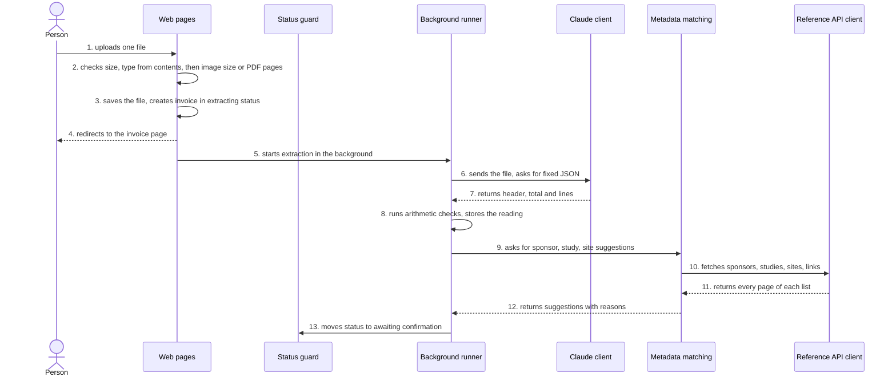

This shows what happens from upload until the confirmation screen is ready.

1. The person picks one file on the upload screen.
2. The page handler refuses a request holding more than one file (422), reads at most 10 MB plus one
   byte, and checks the 10 MB limit, the type from the file's first bytes, then the 7 MB image limit or,
   for PDFs, the 20-page limit and that the PDF opens without a password (the upload checks, R7 and
   R8). A failure answers at once with HTTP 413 for too large, 415 for a wrong type, or 422 for an
   unreadable PDF, and nothing is stored.
3. The file is saved under a generated name (the safe storage rule, R9) and a new invoice row is
   created directly in the extracting status.
4. The browser is sent to the invoice page, which shows "Reading your invoice…" and asks for progress
   about once a second.
5. The status guard hands the extraction to the background runner.
6. The Claude client sends the file as a document (PDF) or an image, with the fixed answer shape
   (section 6), and a 120-second timeout.
7. Claude returns the header facts, the printed total, the yes-or-no "is this an invoice" answer and
   every line.
8. The arithmetic checks run, then the reading and its warnings are stored (the arithmetic rule, R16).
   Each line's quantity times unit price is rounded to the cent before it is compared with the amount.
   A line with a missing quantity, unit price or amount gets the warning "Line N: this line's
   arithmetic couldn't be checked because a number is missing.", and the total check leaves out lines
   with no amount and says how many. Money printed with currency codes or symbols (such as
   `USD 2,230.00` or `€475`) or as an accounting negative (`(50.00)`) is read normally; a value that
   still can't be read as a number is stored as missing with a warning quoting how it was printed, and
   an unreadable printed total is reported as such rather than as "no total printed". If Claude said
   it is not an invoice, the status becomes extraction failed instead (R13). A Retry's reading is timed
   from when Retry was pressed; the first reading from the upload.
9. Metadata matching starts straight away, in the same background job.
10. It fetches all sponsors, studies, sites and study-site links through the reference API client.
11. The client keeps asking for pages until it has all of them (the paging rule, R34).
12. Suggestions with confidence levels and reasons come back (section 7).
13. The status becomes awaiting confirmation, and the next progress check shows the confirmation
    screen.

If Claude errors, refuses or times out, steps 6 and 7 are retried twice and then the status becomes
extraction failed (the extraction failure rule, R62). If the reference API fails in step 10, the
reading is kept and the status becomes extraction failed with the address that failed (R35); Retry
then reruns only metadata matching (R30).

### 4.2 Confirming metadata (the gate)

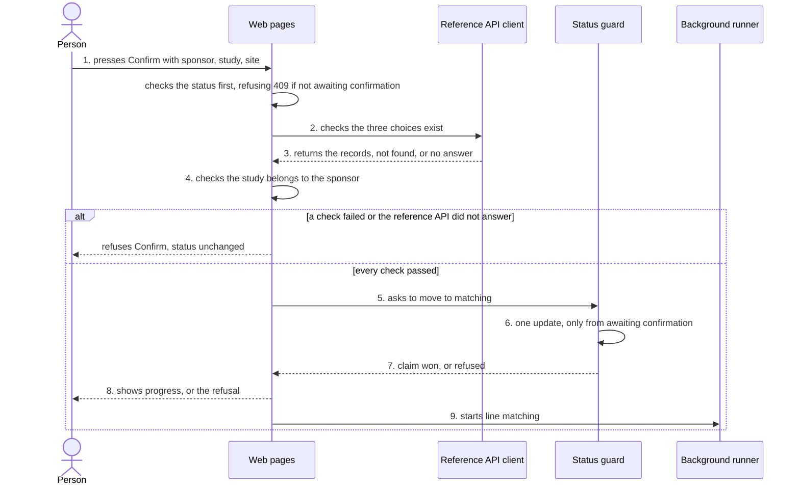

This shows the gate: the only way into line matching.

1. The person presses Confirm. The form sends the chosen sponsor, study and site IDs. The handler first
   checks that the invoice is awaiting confirmation, answering 409 otherwise, whatever the choices are.
   (Opening the confirmation page itself reloads the reference choices; if the reference API doesn't
   answer, the page shows that error.)
2. The handler asks the reference API client for each record.
3. A missing record refuses Confirm with HTTP 422 and a message naming it (the Confirm check, R61).
   If the reference API does not answer, Confirm is refused with HTTP 503 and "Couldn't reach the
   reference API at …; press Confirm to try again". The invoice stays awaiting confirmation;
   pressing Confirm again is the retry. (The reference API failure rule, R35, covers background
   steps; Confirm is answered directly, so it needs no failure status.)
4. If the study's sponsor is not the chosen sponsor, Confirm is refused the same way.
5. The handler asks the status guard to move the invoice from awaiting confirmation to matching.
6. The guard runs one database update that changes the status only if it is still awaiting
   confirmation, and also stores the confirmed IDs and names (the one-at-a-time claim, R29).
7. If no row changed, someone else claimed it or the status was wrong: the handler answers HTTP 409
   Conflict naming the current status (the gate refusing early matching, R28). A double click lands
   here.
8. Otherwise the browser is sent to the review page, which shows "Matching line items: 0 of N done".
9. The guard hands line matching to the background runner, recording the time the request was
   received as the start of the matching run (the timing record, R51).

**Warnings while choosing.** Whenever the person changes the sponsor, study or site picker, the page
asks the server to redraw the warnings for the current choice: the site not being linked to the
study (the cross-check, R22) and an earlier upload with the same invoice number whose site is currently confirmed as the same one
(the duplicate warning, R25). Neither warning blocks Confirm.

There is no other route that starts matching. Retry from matching failed uses the same guard, with
matching failed as the only allowed starting status.

### 4.3 Matching line items

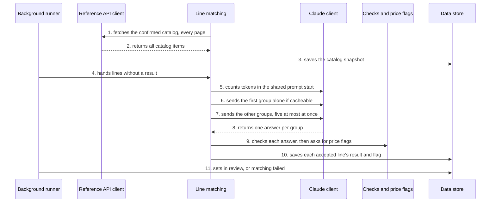

This shows how matches are produced and saved as they arrive.

1. On a first run, line matching fetches the catalog for the confirmed sponsor and study, with
   `page_size=200`, until every page is in (the paging rule, R34). The large catalog is 100 items.
   If the reference API doesn't answer, the invoice goes to matching failed with the address named.
   On Retry, steps 1 to 3 are skipped when a snapshot was saved, and the saved snapshot is used, so every line on the invoice
   is matched against the same catalog.
2. All items come back.
3. They are saved as the invoice's catalog snapshot (section 3). Changing the metadata deletes the
   snapshot, so the next confirmation fetches a fresh one.
4. The lines that have no result yet are handed to line matching, in invoice order. On a first run
   that is every line; on Retry it is only the missing ones (R30).
5. Line matching asks Claude's token-counting endpoint how long the shared prompt start is (the
   instructions plus the catalog).
6. If it is at least the model's minimum cacheable length and there is more than one group, the
   first group of up to six lines is sent alone so it writes the cache (the batching rule, R37). The
   run records the cache as used only if that first request succeeded. If counting fails, or the
   prompt is too short, this step is skipped.
7. The remaining groups are sent at the same time, at most five requests at once.
8. Each request returns one structured answer for its group (section 6).
9. Each answer is checked: one result per line, every catalog ID (including alternatives) in the
   snapshot, at most two alternatives (R40). Accepted lines are kept; only the lines whose answers
   failed the checks are sent once more, as one request. Price flags are then worked out (R43, R44).
   (Separately, the Claude client already tries up to three times for errors and unreadable answers,
   section 6; this resend is for answers that arrived but named lines or items wrongly.)
10. Each accepted line's result and flag are saved straight away, so the next progress check shows
    it (R42). Each save checks, in the same write, that the invoice is still matching; if the user
    changed the metadata meanwhile, the late result is discarded and their change stands.
11. When every line has a result, the status becomes in review and the stored time is recorded. If
    any line is still without one, the status becomes matching failed with the reason (R40, R41), and
    the run's stored time stays empty, since no "last result" moment exists. An unexpected error in
    a group (such as a database lock) is caught in that group, so the run's counts and reason are
    still recorded. The matching-failed screen lists every line, marking those without a result.

### 4.4 Overriding a match

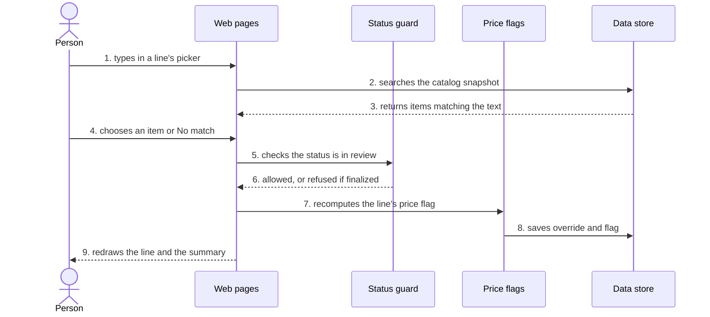

This shows a person replacing the AI's choice for one line.

1. The person types in the picker on a line.
2. The page searches that invoice's catalog snapshot by code and description.
3. Matching items come back as a short list.
4. The person chooses an item, or "No match".
5. The handler asks the status guard to save the override. The guard opens one database
   transaction that first re-reads the status with a write lock and only continues if it is in
   review.
6. Any other status ends the transaction with HTTP 409; a finalized invoice can never change (R33).
   Because the check and the write share one transaction, a Finalize arriving at the same moment
   either happens first (and the override is refused) or waits until the override is saved.
7. Inside the same transaction, the price flag is recomputed for the new choice (R45). "No match"
   clears it.
8. The override is saved beside the AI's original suggestion (R47), and the transaction commits.
9. The page reloads at that line, with the summary updated. Undo is the same flow with the override
   removed. Choosing the AI's own suggestion counts as no override. Each picker starts on the line's
   current item, and search results start with "Choose an item…", which the server refuses, so
   pressing Change without choosing never changes a match.

### 4.5 Finalizing and downloading

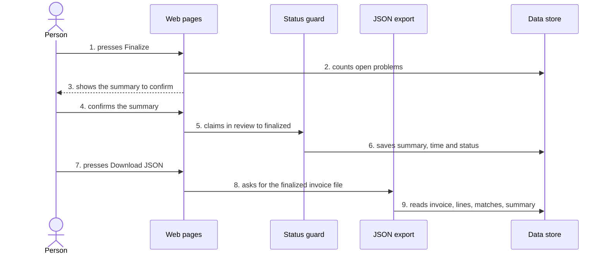

This shows finalizing with acknowledged open problems, then the download.

1. The person presses Finalize on the review screen.
2. The page counts no-match lines, price flags and arithmetic warnings, using current values.
3. The summary is shown, such as "3 lines with no match, 1 price difference, 0 arithmetic warnings"
   (the finalize rule, R49).
4. The person confirms it. The form sends back the counts it showed.
5. The status guard claims the move from in review to finalized. If the counts sent back no longer
   match the current ones, the request is refused and the summary is shown again.
6. The summary, the time and the finalized status are saved.
7. The finalized page shows "Download JSON".
8. The export module builds the file.
9. It reads everything it needs from the data store only, including the catalog snapshot, and
   returns the file with the fields the spec lists (R50); each line also says `"no_match": true` when
   it has no catalog item. The download's file name is the invoice number with every character other
   than letters, digits, dot, dash and underscore replaced, since that number comes from an untrusted
   document. An unknown invoice answers 404, one not yet finalized 409.

## 5. User flow

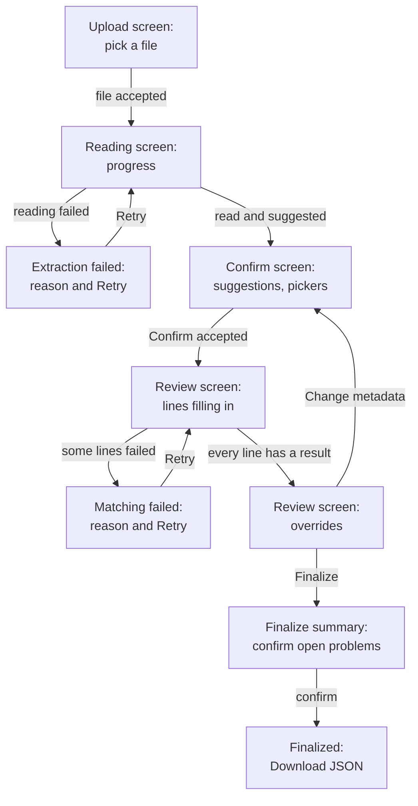

This shows every screen a person sees and what moves them from one to the next. "Change metadata" is
also offered on the matching failed screen; that arrow is left out to keep the diagram readable. The
upload screen also lists past invoices, and each opens at its current screen (R10).

## 6. How Claude is called

Both calls go through the Claude client, which uses the official `anthropic` Python library.

- **Model** comes from `ANTHROPIC_MODEL`, default `claude-opus-5-5`.
- **Answer shape.** Both calls use Claude's structured outputs (`client.messages.parse` with a Pydantic
  model), so the answer is checked against our shape before our code sees it.
- **Effort.** `claude-opus-5-5` always thinks a little and cannot have thinking turned off, so effort
  is the speed control. Extraction starts at `medium` and line matching at `low`. The live tests
  measure both, and the effort can be raised if accuracy falls short.
- **Unusable answers.** A refusal, an answer cut off at the token limit, or an answer that doesn't
  fit the shape counts as failed and goes through the same retry rules as an error. A failed call
  still counts as a request in the run's numbers, and the reason shown never repeats the error's own
  text.
- **Prompts.** The extraction instructions live in `app/prompts/extraction.md`, and the matching
  instructions in `app/prompts/matching_instructions.md`.
- **Timeouts and retries.** The `anthropic` library's own retries are turned off, so these are the
  total. Extraction: 120 seconds per call; matching: 60 seconds per call; each followed by up to two
  more tries after waits of 1 and 3 seconds (R62, R41). A request the API rejects as invalid (an
  HTTP 4xx other than 408, 409 or 429) is not retried, since it would fail the same way. Every
  request sets `max_tokens=16000`.
- **Usage.** Every answer's token counts are added to the current run (R51).
- **The key** is read once from `ANTHROPIC_API_KEY` at startup and is never logged or stored (R4).

**The extraction call** sends one user message holding the file (a `document` block for a PDF, an
`image` block for an image) and a short instruction. The answer shape has the header fields, the
printed total, the "is this an invoice" answer and the list of lines. Every field allows null for
"not printed" (R12). Money is returned as text such as `"550.00"` and converted to exact decimals.

**The matching call** has three parts:

1. The system prompt: fixed instructions, including that invoice text is data and never
   instructions (R38), and that price only breaks ties (R39).
2. The catalog, in a fixed order, with each item's ID, code, description, category and unit price.
   The end of this block carries Claude's cache marker, so everything up to here can be cached (R38).
3. The user message: this group's lines as a JSON list, each line a separate object with its
   position, description, quantity and unit price, followed by a reminder that every description is
   data from an untrusted document. Keeping each line in its own field limits how far a hostile
   description can reach; the hostile-text test (the safety rule, R54) checks that the other lines
   on that invoice still get their expected catalog items.

The answer shape is a list of results, each with the line's position, a catalog item ID or null for
no match, high, medium or low confidence, a one-sentence reason, and up to two alternative IDs.

**Estimated timing for the large invoice** (to be checked by measurement): 27 lines make 5 groups. If
the catalog is too short to cache, all 5 go at once and finish in roughly the time of the slowest one.
If it can be cached, one group goes first, then four at once, which is about two calls' time. With
calls taking roughly 8 to 15 seconds at low effort, both fit inside the 30-second target.

## 7. Metadata matching rules

All comparisons first clean the text: lower case, accents removed, punctuation removed, spaces
collapsed.

- **Exact** means the cleaned text is identical (for a name; a sponsor's short code also counts), or
  the protocol number is identical.
  Company endings are not removed for this test, so "Northwind Pharmaceuticals Inc." is never exact
  for "Northwind Pharma" (R19).
- **Fuzzy score.** For likely and uncertain, the app also removes common company endings ("inc",
  "ltd", "llc", "co", "corp", "company", "pharmaceuticals", "pharma", "therapeutics", "biopharma",
  "life", "sciences") and scores
  similarity with the `rapidfuzz` library's token set ratio, from 0 to 100.
- **Starting thresholds**, tuned by the tests: 85 or more is likely; 60 to 84 is uncertain; below 60
  is not found. Likely also needs a lead of at least 10 points over the second-best candidate.
- **Protocol numbers** are compared segment by segment, split on hyphens. A protocol that differs from
  a real one in exactly one segment is likely, and the reason names that segment ("differs in the
  year" when the segment is a four-digit year) (R20). The study name is always scored too: a name
  that points clearly to a different study lowers an exact protocol match to likely, and a one-segment
  near miss to uncertain, with the conflict named. A study with no protocol match is scored by name
  alone.
- **Sites** add supporting evidence to the name score: the same city and state, and the same
  principal investigator surname. Two facts together, or one fact with a name score of at least 60,
  move the confidence up one level, at most to likely (R21). An exact site name whose printed city,
  state or investigator disagrees with the record is likely, not exact, with the disagreement named.
- **Cross-checks** then run as the spec describes (R22): study against sponsor; sponsor taken from
  the study (never rated above the study's own level); and a site not linked to the study lowering
  the site's confidence by one level. The confirmation screen shows the site-link and duplicate
  warnings as soon as it loads, and redraws them when a picker changes.

Every expected example in the spec (R19, R20, R21 and the four sample invoices) is a unit test, so the
thresholds can be tuned without guessing.

## 8. Data flow (what leaves the laptop)

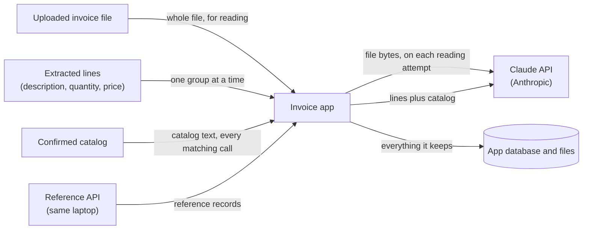

This shows which data leaves the laptop: only the arrows to the Claude API do. The whole invoice file
goes to Anthropic once per reading attempt, and during matching each request carries one group of
line descriptions, quantities and prices plus the full catalog. Nothing else leaves: the reference
API, the app database and the uploaded files all stay on the laptop, and the API key travels only as
the request header to Anthropic. The sample data is fictional, but a real site invoice could hold
personal data, which the README's write-up should note.

## 9. Background work and retries

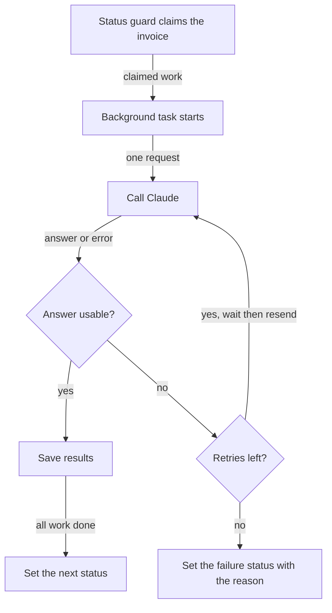

This shows the retry loop every Claude request goes through, inside one background task.

- The runner uses FastAPI's background tasks, which run in the app's own process after the page has
  answered. Line matching runs its groups in a thread pool of five workers, giving the "at most five
  at once" rule (R37). Each worker uses its own database session.
- SQLite runs in write-ahead logging mode so the page's progress reads never block the workers'
  writes.
- Retry counts and timeouts are in section 6. "Answer usable" means it arrived, was not a refusal, and
  passed the shape and catalog checks.
- Every background job runs inside a catch-all. Any error that isn't a handled Claude or reference
  API failure, such as a missing stored file or a database error, sets the running step's failure
  status with the reason "Unexpected error (<error type>); details are in the app log" and is logged, so an invoice never stays in extracting or
  matching while nothing is running. A missing stored file gives the reason "The uploaded file is
  missing; please upload it again", since Retry cannot fix that.
- When the app starts, before taking any requests, it moves every invoice still in extracting or
  matching to its failure status with "Interrupted by an app restart" (R31). Background tasks do not
  survive a restart, which the spec accepts.

## 10. The invoice's status

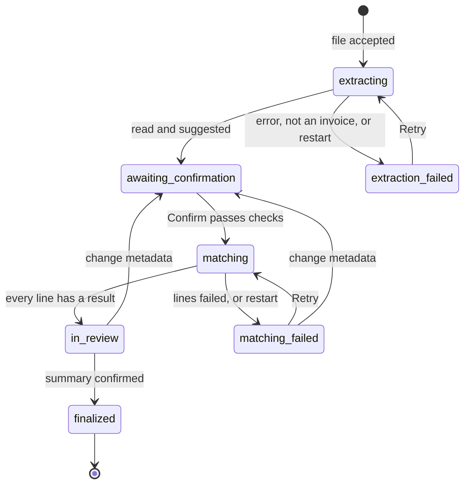

This shows the seven statuses (R27) and every allowed move between them. The status guard holds this
table in code, and any move not shown is refused with HTTP 409. Every write that depends on the
status (claims, overrides, undo, changing metadata, finalizing) checks the status inside the same
database transaction as the write, never in a separate read beforehand. Changing metadata from awaiting
confirmation only changes the pickers, so it is not a status move. While the status is matching,
metadata cannot be changed (R32).

## 11. Pages and form routes

These are the app's routes. They serve the screens and receive form posts; no other program calls
them, but the tests call them directly to prove the gate holds.

| Method and path | What it does | Refusals |
|---|---|---|
| `GET /` | Upload screen and the list of past invoices | |
| `POST /invoices` | Accepts one upload, starts extraction | 413 too large, 415 wrong type, 422 unreadable PDF or several files |
| `GET /invoices/{id}` | The invoice's current screen | 404 unknown invoice |
| `GET /invoices/{id}/progress` | Part of a page, polled about once a second | |
| `GET /invoices/{id}/studies?sponsor_id=` | Study picker choices for a sponsor | |
| `GET /invoices/{id}/warnings?sponsor_id=&study_id=&site_id=` | Redraws the site-link and duplicate warnings for the current choice | |
| `POST /invoices/{id}/confirm` | Confirms sponsor, study and site; starts matching | 409 wrong status, 422 invalid choice, 503 reference API unreachable |
| `GET /invoices/{id}/change-metadata` | The warning of how many matches and overrides will be cleared | 409 wrong status |
| `POST /invoices/{id}/change-metadata` | Clears matches, overrides, the catalog snapshot and the confirmed choices; back to awaiting confirmation | 409 wrong status |
| `POST /invoices/{id}/retry` | Reruns the failed step | 409 wrong status |
| `GET /invoices/{id}/catalog?q=` | Searches the catalog snapshot for a picker | |
| `POST /invoices/{id}/lines/{line_id}/override` | Saves an override or "No match"; choosing the AI's own suggestion clears the override | 404 line not on this invoice, 409 wrong status or line without a result, 422 item not in this invoice's catalog or nothing chosen |
| `POST /invoices/{id}/lines/{line_id}/undo` | Removes an override | 404 line not on this invoice, 409 wrong status or line without a result |
| `POST /invoices/{id}/shown` | The review page, reached straight from live matching, reports that every result is on screen; recorded only once the run has stored every result, only the first time (a write that only succeeds while no time is recorded), and answers with the updated times | 409 run not finished |
| `GET /invoices/{id}/finalize` | The summary to confirm | 409 wrong status |
| `POST /invoices/{id}/finalize` | Finalizes with the confirmed summary | 409 wrong status or changed counts |
| `GET /invoices/{id}/export.json` | The JSON download | 409 not finalized |
| `GET /health` | Says whether the app is up | |

Every `POST` route also answers 403 to a request from another website, and the app answers 400 to any
host name other than `localhost` or `127.0.0.1` (section 12, `cross_site.py`). All pages use Jinja2 templates with automatic escaping turned on, so invoice and Claude text is
always shown as text (R53). htmx is served from the app's own static folder, with no outside download
at run time.

## 12. Code structure

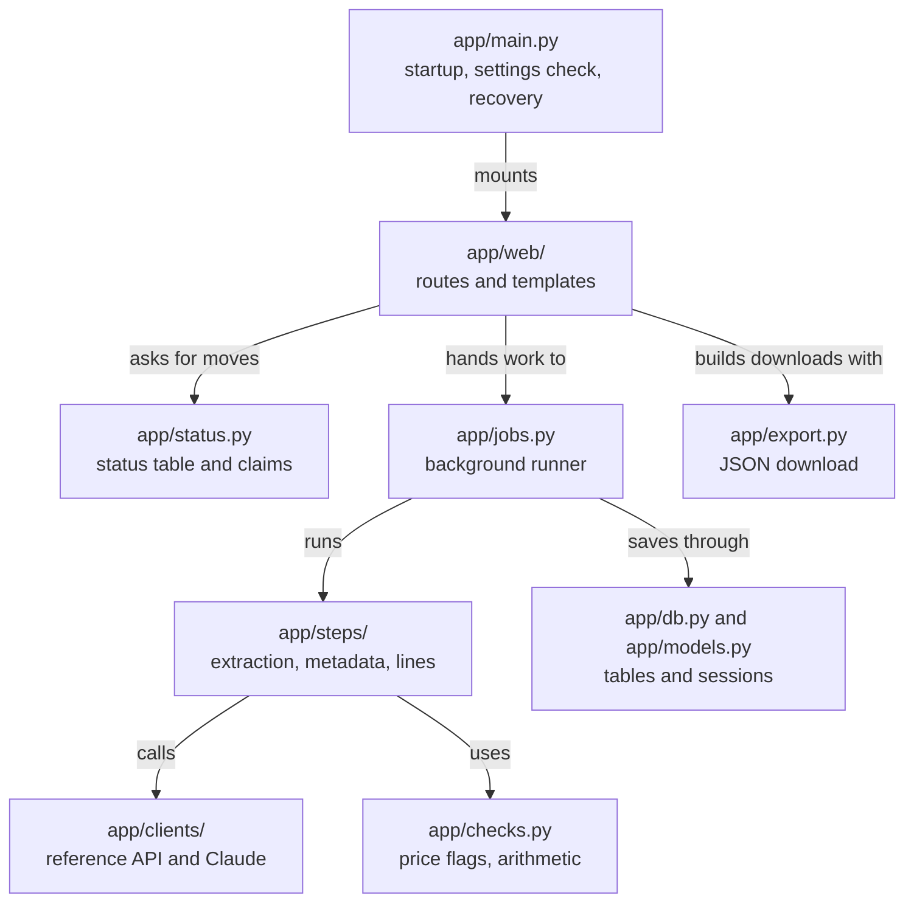

This shows where each part lives and which code uses which.

- `app/__main__.py` (not drawn) is the container's entry point: it reads the settings, exits with code 1
  and a plain message without `ANTHROPIC_API_KEY` (R3), and starts the server.
- `app/main.py` creates the FastAPI app, sets up the database, runs restart recovery (R31), and builds
  the real reference API client from `REFERENCE_API_URL` unless a test passes a stand-in.
- `app/config.py` (not drawn) reads the settings: the three in `.env`, plus `DATA_DIR` (default
  `/data`, where the database and uploads live) and `ALLOWED_HOSTS` (default `localhost` and
  `127.0.0.1`, the only host names served). The API key is held as a secret value that is hidden
  when the settings are printed.
- `app/uploads.py` (not drawn) checks an upload and stores it under a generated name.
- `app/clock.py` (not drawn) gives the current time as ISO 8601 text.
- `app/web/` holds the route handlers (`routes.py` for uploads, progress and the invoice page;
  `confirm.py` for the confirmation screen and the gate; `review.py` for matching progress, the
  review screen, catalog search, overrides, undo and the on-screen time report; `finalize.py` for the
  finalize summary, finalizing and the JSON download), the Jinja2 templates, the static htmx file,
  and `cross_site.py`, which serves only `localhost` and `127.0.0.1` (blocking DNS-rebinding attacks)
  and refuses state-changing requests a browser marks as coming from another site, or whose Origin
  isn't the app's own address and port (HTTP 403).
- `app/prompts/` holds the instructions sent to Claude, starting with `extraction.md`.
- `app/status.py` holds the table of allowed moves and the claim function. It is the only place a
  status is written.
- `app/jobs.py` runs claimed work in the background; `app/steps/line_matching.py` owns the thread
  pool of five.
- `app/steps/extraction.py`, `app/steps/metadata.py` and `app/steps/line_matching.py` are the three
  separate pipeline steps the brief asks for.
- `app/checks.py` holds price flags and the arithmetic checks.
- `app/export.py` builds the JSON download.
- `app/clients/reference_api.py` and `app/clients/claude.py` are the only code that talks to the
  outside.
- `app/db.py` and `app/models.py` hold the SQLAlchemy tables from section 3.
- `tests/` holds the tests: stand-ins for both clients in `tests/fakes.py`, reference API answers
  recorded from the running API in `tests/fixtures/reference/`, saved Claude answers in
  `tests/fixtures/claude/`, the expected results for the four samples in
  `tests/fixtures/expected_results.json`, and the live tests marked `live`.
- `scripts/make_test_files.py` makes the PNG and photo-like test images (R57), using `pypdfium2` to
  draw PDF pages and `Pillow` to rotate and blur, and the hostile-text invoice (R54), using `reportlab`
  through the provided `scripts/generate_sample_invoices.py`.
- `app/report_timings.py` prints the README's timing table (`python -m app.report_timings`); a run
  is a "repeat" when the same file was uploaded within five minutes of its first run.

## 13. Deployment

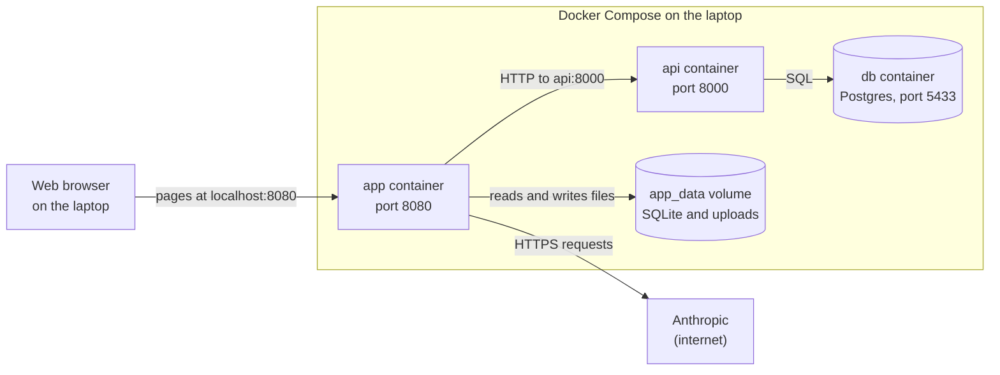

This shows how the pieces run: three containers started by one `docker compose up --build`, with the
app's data on its own volume (R1, R5).

- The new `app` service is added to the existing `docker-compose.yml`. It depends on the `api`
  service, reads `.env`, publishes port 8080 on `127.0.0.1` only (not on other network interfaces),
  and mounts the `app_data` volume at `/data`.
- Inside Compose the app reaches the reference API at `http://api:8000` (the address setting, R2).
- The app image uses Python 3.13 slim, like the reference API's image.
- The reference API and its database are unchanged apart from the earlier one-line fix to keep
  SQLAlchemy on the 2.0 series.

## 14. Libraries

| Library | Used for |
|---|---|
| `fastapi`, `uvicorn` | The web app and its server |
| `jinja2` | Page templates with escaping |
| `python-multipart` | Receiving file uploads |
| `sqlalchemy` (2.0 series) | The SQLite tables |
| `pydantic`, `pydantic-settings` | Answer shapes and settings |
| `anthropic` | Calling Claude |
| `httpx` | Calling the reference API |
| `rapidfuzz` | Fuzzy name comparison |
| `pypdf` | Counting PDF pages for the upload limit |
| `pytest` | Tests |
| `pypdfium2`, `Pillow` | Making test images (test-only) |
| `reportlab` | Making the hostile-text test invoice (test-only) |

`pypdf` is used only to count pages; reading invoice text is always Claude's job (R11).

## 15. Trade-offs and what to revisit

- **Background work in the app process** keeps the build to one container, but work is lost on a
  restart. Restart recovery turns that into a Retry button. Revisit with a job queue if this ever has
  real users.
- **Metadata matching in code** is free, fast and unit-tested, but its thresholds are hand-tuned on
  eight sites and six studies. Revisit with Claude as a judge of close calls if the reference data
  grows.
- **The whole catalog in every matching call** is simple and lets Claude see every option, but it
  grows with the catalog. Revisit with a text-similarity shortlist for catalogs of thousands of
  items.
- **SQLite** needs no server and suits one user, but allows one writer at a time. Fine here; revisit
  for several users.
- **Polling about once a second** is simpler than streaming updates, and costs at most a second of
  delay, which the on-screen time includes honestly.

## Glossary

- **Sponsor, study, site:** the drug company paying, the trial, and the hospital or clinic that bills.
- **Catalog:** the approved billable items and prices for one sponsor and study.
- **Catalog snapshot:** the copy of a catalog saved with an invoice when it is matched.
- **Reference API:** the provided read-only web service holding sponsors, studies, sites and catalogs.
- **Status guard:** the one piece of code allowed to change an invoice's status.
- **Claim:** changing the status in one database update that only succeeds from the expected status,
  so two requests can't both start the same step.
- **Background task:** work the server carries on with after it has already answered the browser.
- **Thread pool:** a fixed set of workers that run tasks side by side; here, five.
- **Write-ahead logging (WAL):** an SQLite mode that lets readers and a writer work at the same time.
- **Structured outputs:** Claude answering in a JSON shape we define and check.
- **Effort:** a Claude setting that trades thinking depth for speed.
- **Prompt cache:** Claude reusing the unchanged start of a prompt, when the request marks where the
  reusable part ends and it is long enough.
- **Token:** a small chunk of text used to measure and bill Claude's input and output.
- **Token set ratio:** a fuzzy score from 0 to 100 that compares the words two texts share.
- **Polling:** the page asking the server for news at a fixed interval.
- **htmx:** a small script that lets a server-rendered page refresh one part of itself.
- **Jinja2:** the template language that turns data into HTML pages.
- **SQLAlchemy:** a Python library for working with databases through Python classes.
- **Docker Compose:** a tool that starts several containers together from one file.
- **Docker volume:** storage that survives a container being recreated.
- **HTTP 409, 413, 415, 422:** the web's codes for "conflicts with the current state", "too large",
  "unsupported file type" and "values are invalid".
- **ISO 8601:** the standard way of writing dates and times as text, such as `2026-10-21T14:03:12Z`.
